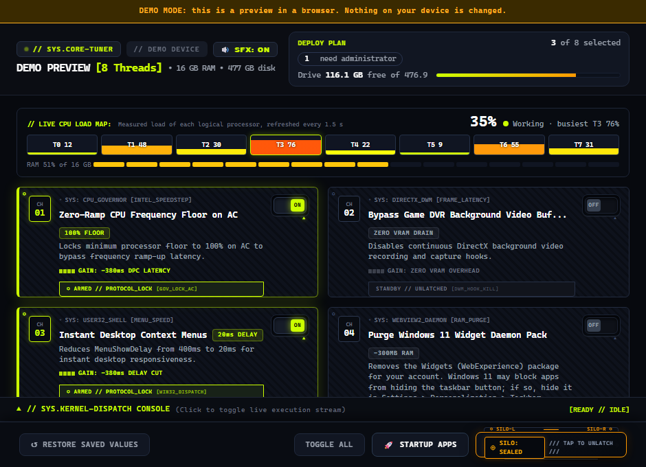
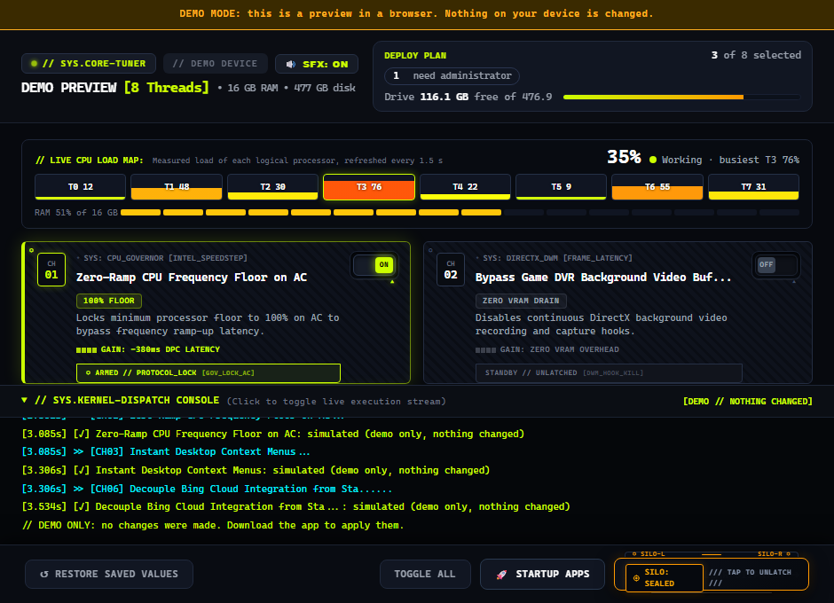
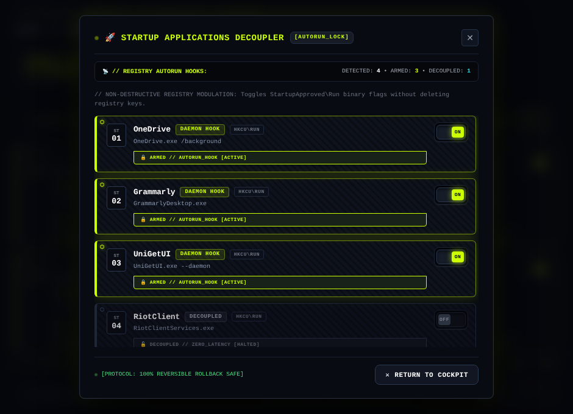

# Laptop Optimizer

A Windows desktop app that applies a fixed set of eight performance and cleanup tweaks (power plan, Game DVR, menu delay, Widgets, hibernation file, Bing search in Start, Delivery Optimization, temp files) and lets you switch startup programs on or off. It is built with Tauri v2 and a Rust backend, with a dark "Cybercore" interface.

**Live preview:** <https://ghost-deku.github.io/laptop-optimizer/> shows the real app UI running in demo mode. It cannot change anything on your computer.

> [!WARNING]
> The app changes Windows settings, uninstalls a Windows component, and deletes files. Before it changes a registry value, power plan or hibernation, it saves the previous value to `%LOCALAPPDATA%\LaptopOptimizer\previous.json`, and Restore puts exactly that back. It does **not** create a Windows restore point, and not every change can be undone (deleted temp files, a removed Widgets pack). Read [What the tweaks do](#what-the-tweaks-do) before you deploy.

## Contents

- [Screenshots](#screenshots)
- [Features](#features)
- [What the tweaks do](#what-the-tweaks-do)
- [Installation](#installation)
- [Usage](#usage)
- [Supported platforms](#supported-platforms)
- [Development](#development)
- [Project structure](#project-structure)
- [Known limitations](#known-limitations)
- [Troubleshooting](#troubleshooting)
- [Contributing](#contributing)
- [License](#license)
- [Acknowledgements](#acknowledgements)

## Screenshots

These images are the app's own interface (`laptop-optimizer-tauri/src/index.html`) rendered in a browser in demo mode, so the hardware details shown (Lenovo 82HS, i7-1165G7) are sample data, not read from the machine that took the screenshot.

| Main window | After deploying |
| :-- | :-- |
|  |  |



## Features

- **Eight tweaks** in one window, each with its own switch. No tweak starts switched on.
- **Deploy** applies every switched-on tweak and prints a result line for each one in a console drawer. A safety cover over the Deploy button must be opened first. Widgets removal and hibernation each ask their own question first, unless they are already applied. A tweak that is already in place is reported as "no change" and nothing is written.
- **Deploy plan** (top right of the header) shows what a deploy would do before you press it: how many tweaks are switched on, how many need administrator rights (and whether the app is running as administrator), how many will ask you to confirm, and the free space on the system drive with the rise since the app opened. It is a card beside the title when there is room and one compact line when the window is narrow.
- **Capacity battery** (the CPU load map) shows the overall CPU load with a plain-language word ("Running calm", "Working", "Busy", "Straining"; these thresholds are the app's own wording, at 25%, 60% and 85% average load), the busiest processor, one cell per logical processor filled by its measured load, and a RAM meter. Values come from Windows' own per-processor counters, refreshed every 1.5 s.
- **Restore Saved Values** puts back the values the app saved before it changed them. A tweak the app never changed is skipped, with a message (see the limits in [What the tweaks do](#what-the-tweaks-do)).
- **Startup applications manager** lists programs in the `Run` registry keys and turns them on or off without deleting the keys.
- **Hardware summary** in the header: processor name, thread count, RAM and system drive size, and system model, read from the registry and Win32 calls.
- **Sound effects** generated in the browser engine (Web Audio API), with a mute toggle in the header. No audio files are used.
- **Runs as administrator.** On launch the app re-starts itself with a UAC prompt if it is not already elevated.

## What the tweaks do

This table is taken from the Rust backend in `laptop-optimizer-tauri/src-tauri/src/optimizer.rs`. Numbers match the card numbers in the app.

| # | Tweak | What the code does | What Restore does |
| :-: | :-- | :-- | :-- |
| 01 | CPU frequency floor | Activates the Windows High Performance power scheme with `powercfg -setactive` and sets `PowerThrottlingOff=1` under `HKLM` (needs administrator rights; applies after a restart). It does not set a processor-state value itself. | Reactivates the power plan that was active before, and puts back the saved `PowerThrottlingOff` value (or deletes it if it did not exist). |
| 02 | Game DVR | Sets `GameDVR_Enabled`, `AppCaptureEnabled` and `HistoricalCaptureEnabled` to 0 and writes two full-screen behaviour values under `HKCU`. | Puts back all five saved values, or deletes the ones that did not exist. |
| 03 | Menu delay | Sets `MenuShowDelay` to `20` in `HKCU\Control Panel\Desktop`. | Puts back the saved value (for example your own, not a fixed 400). |
| 04 | Widgets | Tries to hide the taskbar Widgets button (`TaskbarDa=0`; **Windows 11 build 26320 refuses this write from any app**, so hide the button in Settings > Personalization > Taskbar), ends `WidgetService.exe`, and removes the Windows Web Experience package for the current account with PowerShell `Remove-AppxPackage` (never `winget`). Asks its own question first. | Puts back the saved `TaskbarDa` value. **The removed package is not reinstalled.** |
| 05 | Hibernation file | Runs `powercfg -h off`, which also turns off Fast Startup and deletes `hiberfil.sys`. Asks its own question first. | Runs `powercfg -h on` or `off`, whichever it was before. |
| 06 | Bing in Start | Sets `BingSearchEnabled=0` under `HKCU` and ends `SearchHost.exe`. | Puts back the saved value. |
| 07 | Delivery Optimization | Sets the machine policy `HKLM\SOFTWARE\Policies\Microsoft\Windows\DeliveryOptimization\DODownloadMode=0` (HTTP only; needs administrator rights), then asks Windows (`Get-DOConfig`) whether the mode really changed, and reports success only if it did. Tested on Windows 11: the old per-user key left the mode at `Lan`; this policy makes Windows report `CdnOnly`. Settings may then say some settings are managed by your organization. | Deletes the policy value again if it did not exist before (and the policy key if that leaves it empty), or puts back the saved value. |
| 08 | Temp files | Deletes items directly inside your own `%TEMP%` folder when everything in them is older than 24 hours. A folder with any recent file inside is kept. Items in use are skipped. | Nothing. Deleted files cannot be restored. |

Restore works only from what the app saved before its first change to that tweak. If nothing was saved (for example changes made by an older version), Restore changes nothing and says so. If you (or Windows) changed a value after the app set it, Restore does not silently replace your newer value: it names those tweaks and asks. OK replaces them with the saved original; Cancel leaves them as they are and still restores everything else. The check is enforced in the backend, so a skipped tweak keeps its saved value and you can run Restore again. If the saved-values file cannot be read or written, the app refuses to change anything.

The labels in the app such as "−380ms" (400 − 20), "−300MB" and "+1.4GB CLEARED" are fixed text. Only the menu-delay number is arithmetic from the setting; the RAM and disk figures are **not measured**. The app also does not check whether Windows honours each setting on your version.

## Installation

> [!IMPORTANT]
> The files on the [Releases page](https://github.com/GHOST-DEKU/laptop-optimizer/releases/latest) are built automatically by GitHub Actions from the source in this repository when a tag starting with `v` is pushed. They are **not code-signed**, so Windows SmartScreen may warn. `v2.5.0` was started and checked on one Windows 11 PC (SHA-256 matches, the app opens). It has not been tested on Windows 10 or on a clean PC. `PRODUCTION_READINESS_PLAN.md` lists what is tested and what is not.

**Option 1: portable executable.** Download [`LaptopOptimizer.exe`](https://github.com/GHOST-DEKU/laptop-optimizer/releases/latest/download/LaptopOptimizer.exe) from the latest release. It is one file (about 9 MB), nothing to install. Every release has a `SHA256SUMS.txt`; compare it with your download using `Get-FileHash .\LaptopOptimizer.exe`. If you prefer not to trust a prebuilt file, build it yourself (see [Development](#development)).

You can also run `Run-Optimizer.bat` (from this repository), which starts the executable with administrator rights. It does not remove the "downloaded from the internet" mark. It must sit in the same folder as `LaptopOptimizer.exe`.

**Option 2: installers.** The same release has an MSI and an NSIS setup file (`.msi`, `-setup.exe`), also listed in `SHA256SUMS.txt`. The installers have not been run on a clean PC yet.

The app needs Microsoft Edge WebView2. It is included in Windows 10 (version 1803 and later) and Windows 11.

## Usage

1. Start the app and accept the UAC prompt.
2. Click a card to switch a tweak on, or use **TOGGLE ALL**. No tweak starts switched on. Only switch on what you want.
3. Click the cover over the Deploy button (**SILO: SEALED**). It changes to **WARHEAD: ARMED**.
4. Click **LAUNCH NUCLEAR DISPATCH**. The console drawer opens and logs each step. Failed steps are marked `[✗]` with the error.
5. To open or close the console by hand, click its header bar.
6. **STARTUP APPS** opens the startup manager. Click a row to switch that program on or off for the next sign-in.
7. **RESTORE SAVED VALUES** asks for confirmation, then applies the Restore column above. Tweaks the app never changed are skipped.

## Supported platforms

| Platform | Status |
| :-- | :-- |
| Windows 10 / 11, 64-bit | Target platform. The release workflow builds `x86_64-pc-windows-msvc`. Tested so far on **one Windows 11 PC** only (Rust tests, source checks, page tests, one tweak applied and restored by hand). Windows 10, a clean VM and a second user account are not tested. |
| Other Windows builds (32-bit, ARM) | Not built by the workflow. Not verified. |
| Linux, macOS | Not supported. The Rust backend uses Windows-only APIs (`winreg`, `std::os::windows`) and will not compile there. |

## Development

### Prerequisites (Windows)

From the [Tauri v2 prerequisites](https://v2.tauri.app/start/prerequisites):

- Microsoft C++ Build Tools with the "Desktop development with C++" workload
- Microsoft Edge WebView2 (already present on Windows 10 1803+ and Windows 11)
- Rust, installed with the MSVC toolchain (`rustup default stable-msvc`)
- Node.js (the release workflow uses version 20)
- pnpm 12.18.0, the version pinned in `package.json` (`corepack enable` will provide it)
- VBSCRIPT enabled, only if you build the MSI installer

### Run and build

```bash
cd laptop-optimizer-tauri
pnpm install
pnpm tauri dev      # run the app in development
pnpm tauri build    # production build: MSI and NSIS installers
```

`pnpm dev` and `pnpm build` are shortcuts for the same two commands. Build output is written under `laptop-optimizer-tauri/src-tauri/target/release/`, with installers in the `bundle` folder. Use `tauri build` rather than a plain `cargo build --release`, because the Tauri CLI is what prepares a production build.

`pnpm install` and `pnpm tauri build` were run on Windows 11 on 2026-11-12 and produced an MSI and an NSIS installer. A local build contains the build machine's Cargo folder path; only the tagged CI build remaps it. `cargo test --lib` (in `src-tauri`) runs the Rust tests; `python tests/source_guards.py` and `python tests/ui_regression.py` (needs `playwright`) run the other checks.

### Try the interface without Tauri

Open `laptop-optimizer-tauri/src/index.html` in any browser. Outside Tauri the page uses built-in sample data and makes no system changes. The website preview embeds this same file, so a change to it shows up on the site as well.

## Project structure

```text
.
├── laptop-optimizer-tauri/       Current application
│   ├── package.json              pnpm scripts (dev, build) and the Tauri CLI
│   ├── src/index.html            Interface markup and styles
│   ├── src/app.js                Interface logic (calls the Rust commands)
│   ├── tests/                    source_guards.py and ui_regression.py
│   └── src-tauri/
│       ├── src/main.rs           Entry point, relaunches as administrator
│       ├── src/lib.rs            Tauri commands exposed to the interface
│       ├── src/optimizer.rs      Registry, powercfg and file operations
│       ├── src/safety.rs         Lock, timeouts, confirmations, temp purge rules
│       ├── src/journal.rs        Saved previous values used by Restore
│       ├── tauri.conf.json       Window size, bundle targets, icons
│       └── capabilities/         Tauri permission set
├── index.html                    Project website (GitHub Pages), embeds the app UI
├── Run-Optimizer.bat             Run-as-administrator helper
├── docs/screenshots/             Images used in this README
└── .github/workflows/             ci.yml (tests), pages.yml (website), release.yml (build and publish on `v*` tags)
```

The interface talks to Rust through nine commands: `get_system_info`, `get_live_telemetry`, `get_elevation`, `is_applied`, `apply_tweak`, `restore_tweak`, `restore_all`, `get_startup_apps` and `toggle_startup_app`. Only these are allowed (see `build.rs` and `capabilities/default.json`). The page currently uses `restore_all` and not `restore_tweak`.

## Known limitations

- **Restore uses what the app saved.** It cannot restore changes made before the app saved anything, or changes you made by hand after the app changed a setting (it would put the saved value back over yours).
- **Some changes are permanent:** deleted temp files and the removed Web Experience package.
- **The startup manager only covers the `Run` keys** under `HKCU` and `HKLM`. It does not cover the Startup folder, `RunOnce`, the 32-bit `Run` view or scheduled tasks. On/off is read from the first byte of the `StartupApproved` value: even means on, odd means off (inferred from one Windows 11 PC).
- **Sample startup entries are shown only in the browser demo,** never in the installed app.
- **Not every telemetry value is shown.** The window shows the device model, processor name, thread count, total RAM, per-processor CPU load, RAM use, and the free space on the system drive (refreshed every 1.5 s). The backend also reads the processor's base clock (MHz), but the page has no element for it. The old wave in the header was decoration (it only reacted to the number of switched-on tweaks) and has been removed.
- **The "NVMe" label is fixed text** in the header, and the drive size is rounded to a common size (256, 512 or 1024 GB).
- **Download mark:** the app no longer removes the "downloaded from the internet" mark from its own file.
- **Network use:** the app's own code contains no analytics or network calls. The installers can download WebView2 if it is missing.
- **Version numbers:** `tauri.conf.json` and `Cargo.toml` say 2.5.0; `package.json` says 1.0.0 (not used for the release). The version shown in the interface was not checked.

## Troubleshooting

| Problem | What to try |
| :-- | :-- |
| SmartScreen warns about the file | The executable is unsigned. Choose "More info", then "Run anyway", or build from source. |
| Some deploy steps show `[✗]` | The app probably is not elevated, for example after declining the UAC prompt. Close it and start it again, accepting the prompt. |
| Window stays blank or the app will not start | Install the [WebView2 Evergreen runtime](https://developer.microsoft.com/microsoft-edge/webview2/). |
| Widgets button or panel is gone after Restore | Restore does not reinstall the package. Reinstall "Windows Web Experience Pack" from the Microsoft Store. |
| `pnpm install` complains about the package manager version | Run `corepack enable` and use pnpm 12.18.0. |
| MSI build fails | Check that VBSCRIPT is enabled (Settings, Apps, Optional features, More Windows features). |
| Build fails on a missing linker | Install the "Desktop development with C++" workload and use the MSVC Rust toolchain. |

## Contributing

Issues and pull requests are welcome at <https://github.com/GHOST-DEKU/laptop-optimizer>. The repository has no automated tests or contribution guide yet, so please:

- keep each pull request focused on one change,
- describe how you tested it, since the Tauri app only runs on Windows,
- check interface changes in a browser using `laptop-optimizer-tauri/src/index.html`, and
- avoid committing build output or secrets.

## License

Released under the [MIT License](LICENSE).

## Acknowledgements

Built with [Tauri](https://tauri.app), [serde](https://serde.rs), the [`winreg`](https://crates.io/crates/winreg) crate and `tauri-plugin-log`.
